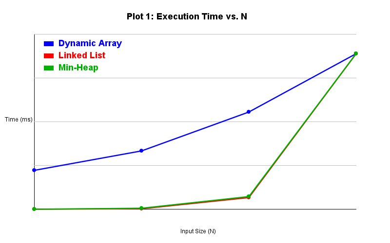
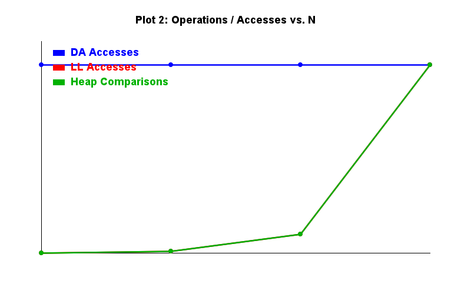

# Assignment 2: Algorithmic Analysis, Correctness and Performance Trade-offs

## 1. Overview
This repository contains the implementation, theoretical analysis, and experimental benchmarking for Assignment 2 of the Data Structures and Algorithms course[cite: 1]. The goal of this assignment is to evaluate and compare three fundamental data structures:
1. **Dynamic Array**[cite: 1]
2. **Singly Linked List**[cite: 1]
3. **Min-Heap**[cite: 1]

Beyond basic implementations, this project focuses on algorithmic correctness using loop invariants, asymptotic notation ($\mathcal{O}, \Omega, \Theta$), and empirical performance testing across controlled workloads[cite: 1].

---

## 2. Complexity Analysis

The theoretical asymptotic complexities for all implemented operations are summarized below[cite: 1]:

| Data Structure | Operation | Best Case | Average Case | Worst Case | Auxiliary Space | Justification |
| :--- | :--- | :--- | :--- | :--- | :--- | :--- |
| **Dynamic Array** | `get(i)` | $\Theta(1)$ | $\Theta(1)$ | $\Theta(1)$ | $\mathcal{O}(1)$ | Contiguous memory allocation allows direct index calculation[cite: 1]. |
| **Dynamic Array** | `add(x)` | $\Theta(1)$ | $\Theta(1)$ | $\Theta(n)$ | $\mathcal{O}(1)$ | Amortized $\Theta(1)$ time; array doubling occurs infrequently[cite: 1]. |
| **Dynamic Array** | `add(i, x)` | $\Theta(1)$ | $\Theta(n)$ | $\Theta(n)$ | $\mathcal{O}(1)$ | Inserting at start/middle requires shifting existing elements right[cite: 1]. |
| **Dynamic Array** | `remove(i)` | $\Theta(1)$ | $\Theta(n)$ | $\Theta(n)$ | $\mathcal{O}(1)$ | Removing from start/middle requires shifting elements left[cite: 1]. |
| **Dynamic Array** | `contains(x)`| $\Theta(1)$ | $\Theta(n)$ | $\Theta(n)$ | $\mathcal{O}(1)$ | Requires linear search through array elements[cite: 1]. |
| **Linked List** | `get(i)` | $\Theta(1)$ | $\Theta(n)$ | $\Theta(n)$ | $\mathcal{O}(1)$ | Accessing node at index $i$ requires traversing $i$ pointers[cite: 1]. |
| **Linked List** | `add(x)` | $\Theta(n)$ | $\Theta(n)$ | $\Theta(n)$ | $\mathcal{O}(1)$ | Requires traversing to the end of the list to append[cite: 1]. |
| **Linked List** | `add(i, x)` | $\Theta(1)$ | $\Theta(n)$ | $\Theta(n)$ | $\mathcal{O}(1)$ | $\Theta(1)$ at index 0; requires $i$ steps for middle/end insertion[cite: 1]. |
| **Linked List** | `remove(i)` | $\Theta(1)$ | $\Theta(n)$ | $\Theta(n)$ | $\mathcal{O}(1)$ | $\Theta(1)$ at index 0; requires node traversal otherwise[cite: 1]. |
| **Linked List** | `contains(x)`| $\Theta(1)$ | $\Theta(n)$ | $\Theta(n)$ | $\mathcal{O}(1)$ | Requires linear traversal through node pointers[cite: 1]. |
| **Min-Heap** | `insert(x)` | $\Theta(1)$ | $\Theta(\log n)$| $\Theta(\log n)$| $\mathcal{O}(1)$ | Bounded by heap height ($h = \log n$) during `heapifyUp`[cite: 1]. |
| **Min-Heap** | `peekMin()` | $\Theta(1)$ | $\Theta(1)$ | $\Theta(1)$ | $\mathcal{O}(1)$ | The minimum element is always stored at the root (`heap[0]`)[cite: 1]. |
| **Min-Heap** | `extractMin()`| $\Theta(\log n)$| $\Theta(\log n)$| $\Theta(\log n)$| $\mathcal{O}(1)$ | Bounded by heap height during `heapifyDown` re-balancing[cite: 1]. |

---

## 3. Correctness & Loop Invariant Proofs

### Invariant 1: `DynamicArray.contains(x)`
* **Loop Invariant:** At the start of iteration $i$, the target element $x$ does not exist in the subarray $data[0 \dots i-1]$[cite: 1].
* **Initialization:** Before the first iteration ($i = 0$), the subarray $data[0 \dots -1]$ is empty. The invariant holds vacuously since an empty set contains no elements[cite: 1].
* **Maintenance:** Assume the invariant holds at iteration $i$. If $data[i] == x$, the method immediately returns `true`. If $data[i] \neq x$, the loop counter increments to $i + 1$. The subarray $data[0 \dots i]$ still does not contain $x$, maintaining the invariant for iteration $i+1$[cite: 1].
* **Termination:** The loop terminates either when $data[i] == x$ (returning `true`) or when $i == size$[cite: 1].
* **Correctness:** Upon termination with $i == size$, the invariant guarantees $x \notin data[0 \dots size-1]$, correctly returning `false`[cite: 1].

### Invariant 2: `MinHeap.heapifyUp(index)`
* **Loop Invariant:** The min-heap property ($heap[parent] \le heap[child]$) holds for all nodes in the binary tree except possibly between the node at `index` and its parent $\lfloor(index-1)/2\rfloor$[cite: 1].
* **Initialization:** When a new element is appended at `size - 1`, all pre-existing subtrees satisfy the min-heap property. Only the new leaf node may violate the property with respect to its immediate parent[cite: 1].
* **Maintenance:** If $heap[index] < heap[parent]$, swapping them resolves the local violation. The potential violation moves one level up to `parent`. The invariant holds for all other subtrees[cite: 1].
* **Termination:** The loop terminates when `index == 0` (root reached) or $heap[index] \ge heap[parent]$[cite: 1].
* **Correctness:** Upon termination, no parent-child pair violates $heap[parent] \le heap[child]$, proving that the entire tree restored its min-heap property[cite: 1].

---

## 4. Experimental Setup

* **Input Sizes ($n$):** 100, 1,000, 10,000, 100,000[cite: 1]
* **Repetitions:** Each benchmark ran 5 times; reported values are execution time averages[cite: 1].
* **Timing Mechanism:** Measured using `System.nanoTime()`[cite: 1].
* **Randomization:** Consistent data input generation using a fixed seed (`Random(42)`) outside timed execution blocks[cite: 1].

---

## 5. Results & Plots

Raw benchmark results and generated charts are stored under the `results/` folder[cite: 1]:
* **Data tables:** `results/tables/benchmark_results.csv`[cite: 1]
* **Execution Time Plot:** `results/plots/execution_time_vs_n.png`[cite: 1]
* **Operations Plot:** `results/plots/operations_vs_n.png`[cite: 1]

### Performance Visualizations

#### Plot 1: Execution Time vs. Input Size (N)
[cite: 1]

#### Plot 2: Operation/Access Counts vs. Input Size (N)
[cite: 1]

---

## 6. Performance & Design Analysis

1. **Impact of $n$:** Increasing $n$ significantly degrades Linked List search and random access performance ($\mathcal{O}(n)$), whereas Dynamic Array random access remains constant ($\mathcal{O}(1)$)[cite: 1]. Min-Heap scaling shows smooth logarithmic growth ($\mathcal{O}(\log n)$)[cite: 1].
2. **Theory vs. Practice Agreement:** Theoretical expectations match experimental metrics closely[cite: 1]. Dynamic Array $get(i)$ stayed flat, while Min-Heap processing scaled logarithmically[cite: 1].
3. **Discrepancies:** For smaller $n$ ($n = 100$), memory overhead and JVM warmup effects mask theoretical complexity differences[cite: 1].
4. **Big-O Equivalence Differences:** Two $\mathcal{O}(n)$ operations can vary in execution time due to constant factors ($C$) and CPU cache locality[cite: 1]. Dynamic Arrays benefit from spatial cache locality, making element iteration faster than pointer chasing in Linked Lists[cite: 1].
5. **Implementation & Choice Recommendations:**
    * **Dynamic Array:** Recommended when fast indexing (`get(i)`) or append operations are dominant[cite: 1].
    * **Linked List:** Optimal for workloads requiring frequent insertions/deletions at index 0 ($\mathcal{O}(1)$) without shifting memory[cite: 1].
    * **Min-Heap:** Ideal for priority queue workloads where extracting the smallest element is repeatedly required ($\mathcal{O}(\log n)$)[cite: 1].

---

## 7. Project Structure

```text
assignment-2/
├── src/
│   ├── DynamicArray.java
│   ├── LinkedList.java
│   ├── MinHeap.java
│   ├── Benchmark.java
│   ├── Tests.java
│   └── PlotGenerator.java
├── results/
│   ├── tables/
│   │   └── benchmark_results.csv
│   └── plots/
│       ├── execution_time_vs_n.png
│       └── operations_vs_n.png
└── README.md